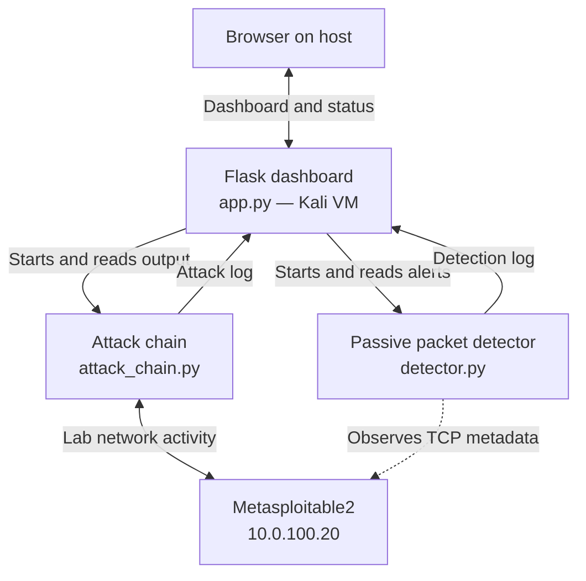

# Mini Cyber Range: Attack Simulation and Detection Dashboard

A small educational cyber-range project for observing how selected lab activity appears in attack-side logs and passive network telemetry. The project connects a Python attack-chain script, a Scapy-based detector, and a Flask dashboard in an isolated virtual lab.

This is a teaching prototype. It is not a production NIDS, a general-purpose security scanner, or a validated method for identifying every attack or successful login.

## Architecture

The Kali VM and Metasploitable2 VM should be connected through the same isolated VirtualBox internal network. Example lab addresses are Kali `10.0.100.10` and Metasploitable2 `10.0.100.20`; use the addresses configured in your environment.

## Components

| Component | File | Role |
|---|---|---|
| Dashboard and orchestration | `app.py` | Serves the Flask page, starts the lab components, reads their logs, and presents the run output. |
| Attack chain | `attack_chain.py` | Performs the configured lab workflow using Nmap for discovery and Paramiko for SSH interactions. |
| Packet detector | `detector.py` | Uses Scapy to observe TCP packet metadata and report selected traffic patterns. |
| Attack log | `attack_log.txt` | Stores output from the attack-chain process as captured by the dashboard. |
| Detection log | `detection_log.txt` | Stores messages produced by the detector. |

The attack chain uses **Nmap and Paramiko**. The target is **Metasploitable2**. The code described here does not invoke the Metasploit Framework.

## Demonstration workflow

1. The user starts a run from the dashboard.
2. For a lab-chain run, the dashboard starts the detector before starting the attack-chain process.
3. The attack chain performs its configured stages against the lab target and prints progress.
4. The dashboard captures that output and displays it in the attack panel.
5. The detector observes packets on its configured interface and writes findings to the detection log.
6. The dashboard displays the detector output separately from the attack-chain output.
7. The report view presents the logs in a printable format that can be saved as a PDF.

The two output panels show different evidence sources. The attack chain can report results it receives directly from a service. The packet detector reports patterns visible in network traffic.

## Attack-chain stages

The chain is intended to demonstrate these activities in the isolated lab:

1. **Reconnaissance:** Nmap identifies selected open ports and service information on the configured target.
2. **Service enumeration:** the script performs follow-up checks on selected services and records observations such as banners or HTTP responses.
3. **SSH authentication demonstration:** Paramiko receives the SSH server’s authentication response. The chain can therefore log whether an attempted authentication was rejected or accepted.
4. **Post-login triage:** after successful SSH authentication, the chain requests basic system information and logs the returned output.

The chain's authentication result is separate from the detector's packet observations. Do not interpret a detector SSH alert as proof that a password failed or succeeded.

## Detection behavior

The detector uses Scapy to inspect packet metadata such as IP addresses, ports, TCP flags, and whether a TCP packet carries payload. Its current rules include:

- **Connection probe:** logs selected TCP SYN observations and labels destination ports using a static service-name map.
- **Port-scan pattern:** reports a source/destination pair when the configured number of distinct ports is observed inside the configured time window.
- **SSH connection burst:** reports repeated SYN packets directed to TCP port 22 within its configured window.
- **SSH payload activity:** notes that traffic involving SSH carried payload. SSH contents remain encrypted and are not inspected.

These are rule-based indicators, not proof of malicious intent. A SYN is a connection-attempt signal; it does not prove a connection completed. The detector cannot determine from encrypted SSH packets alone whether authentication succeeded, whether a password was submitted, or what commands were sent.

### Optional login-timing demonstrations

The timing heuristic classifies the event sequence as *human-like timing* or *automation-like timing*. These labels describe timing patterns in the generated demo events.

## MITRE ATT&CK references

These mappings describe behaviors demonstrated by the attack chain. They do not mean the detector independently confirms every technique.

| Technique ID | Name | Project context |
|---|---|---|
| T1046 | Network Service Discovery | Nmap service discovery and related probe pattern |
| T1110.001 | Password Guessing | SSH password-guessing behavior in the attack chain |
| T1059.004 | Unix Shell | Shell activity after an SSH session is established |
| T1082 | System Information Discovery | Post-login system-information collection |

The project's Stage 2 service-enumeration label should be reviewed before assigning T1592. A technique mapping should be supported by the specific behavior performed, not copied solely from a code comment.

## Requirements and setup

The project uses Python and the packages listed in `requirements.txt`. The lab also requires Nmap to be installed on Kali. Scapy packet capture may require elevated privileges and the correct interface selection.

## Logs and report

The dashboard keeps attack-chain output and detector findings in separate logs and displays them separately. Its print/report view formats the available operation logs for printing or saving as PDF. It should be described as a **log report**, not as an automated incident analysis or remediation system unless those features are implemented in the submitted code.

## Technology stack

Python, Flask, Nmap (`python-nmap`), Paramiko, Scapy, HTML, CSS, JavaScript, VirtualBox, Kali Linux, and Metasploitable2.